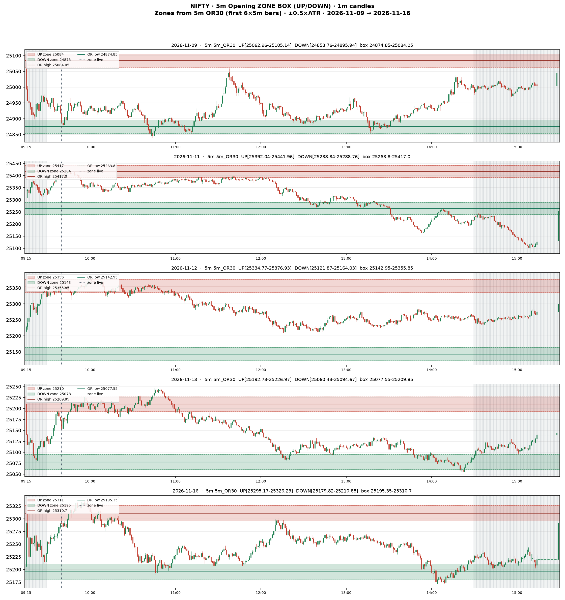

# NIFTY — Opening ZONE BOX on **5m** · chart with **1m candles**

> **RESEARCH ONLY.**

Stats window **2026-10-15 → 2026-11-16** · Chart **2026-11-09 → 2026-11-16**.

## 5m zone definition (same idea as 1m OR)

```
5m_OR15 = high/low of first 3 × 5m bars  (~09:15–09:30)
5m_OR30 = high/low of first 6 × 5m bars  (~09:15–09:45)
UP zone   = OR high ± 0.5×ATR(5m)
DOWN zone = OR low  ± 0.5×ATR(5m)
Retest scored on 1m path after leave (swing ≥15pts vs break ≥1×ATR)
```

## 5m zone proven (swing vs break)

| Method | Retests | Swing% | Break% | Decisive% | Avg swing bounce |
|---|---:|---:|---:|---:|---:|
| `5m_OR15` | 32 | **81.25** | 18.75 | 100.0 | 46.79 |
| `5m_OR30` | 30 | **86.67** | 13.33 | 100.0 | 43.44 |

## Chart



Red band = UP zone · Green band = DOWN zone · Horizontal lines = OR high/low · Candles = **1m**.

Elapsed 38s
