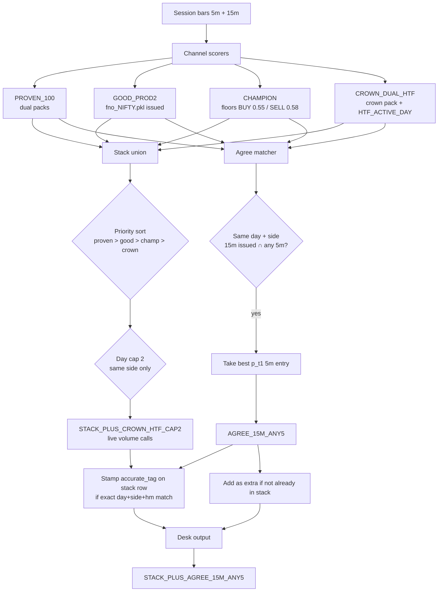
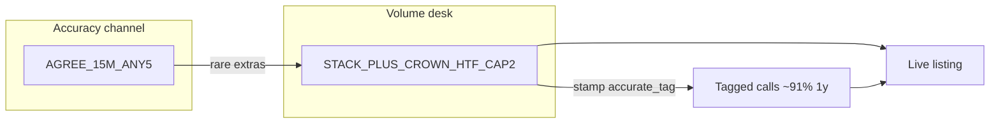
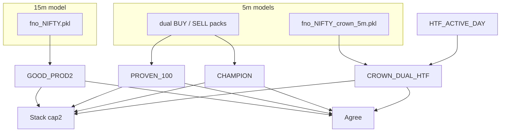

# Final desk — design diagram

**Package:** `prod_live` · **Status:** FINALIZED · **Symbol:** NIFTY

## 1. Session call flow

## 2. Channel roles

## 3. Model map

## 4. Decision rules (short)

| Step | Rule |
|---|---|
| 1 | Score all four channels on the session |
| 2 | Drop crown unless `HTF_ACTIVE_DAY` |
| 3 | Sort by priority → higher `p_t1` → earlier time |
| 4 | Keep max **2** calls; lock **same side** after first pick |
| 5 | If issued 15m and any 5m share day+side → agree entry = best 5m `p_t1` |
| 6 | Stamp `accurate_tag=AGREE_15M_ANY5` when stack row equals that entry |
| 7 | NSE mid / daily fill / 15m classic standalone stay **OFF** |

## 5. Confirmed 1y snapshot

| Book | N | Hit |
|---|---:|---:|
| Live stack | 229 | 75.11% |
| Accurate tagged | 54 | 90.74% |
| Agree alone | 55 | 90.91% |

Detail: `reports/1y/LIVE_FINAL_1Y_MONTHS_ACCURATE.md`

---

## Holding (not finalized)

Stack + empty fill T35 is packaged separately — see **`HOLDING_DESIGN.md`** / **`HOLDING_LOGIC.md`**.  
Live cutover stays on this FINALIZED diagram until promote.
