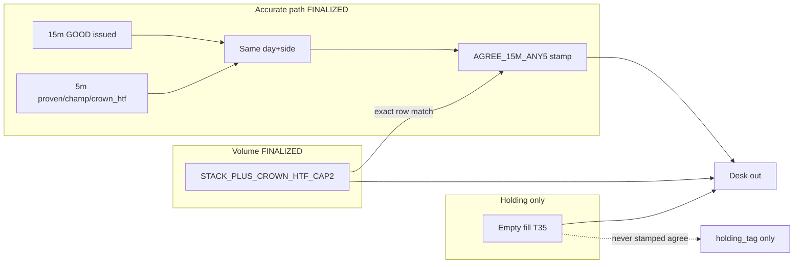

# Holding desk — design diagram

**Package:** `prod_live` · **Status:** HOLDING (not finalized) · **Symbol:** NIFTY  
**Base:** FINALIZED stack + agree · **Add-on:** empty fill V2 (T35)

## 1. Full holding session flow

```mermaid
flowchart TD
  A[Session bars 5m + 15m + daily prior] --> B[Channel scorers]
  B --> C1[PROVEN_100]
  B --> C2[GOOD_PROD2]
  B --> C3[CHAMPION floors]
  B --> C4[CROWN + HTF_ACTIVE_DAY]

  C1 --> D[Stack union]
  C2 --> D
  C3 --> D
  C4 --> D
  D --> E[Priority proven greater good greater champ greater crown]
  E --> F[Day cap 2 same side]
  F --> G[STACK_PLUS_CROWN_HTF_CAP2 FINALIZED]

  C2 --> H[Agree matcher]
  C1 --> H
  C3 --> H
  C4 --> H
  H --> I{Same day + side 15m issued AND any 5m?}
  I -->|yes| J[Best p_t1 5m entry]
  J --> K[AGREE_15M_ANY5 FINALIZED]
  K --> L[Stamp accurate_tag on exact stack row only]
  G --> L

  G --> M{Stack calls today = 0?}
  M -->|no| N[No empty fill]
  M -->|yes| O{|gap| >= 0.55%?}
  O -->|no| N
  O -->|yes| P[10:30 fade open T35/S35]
  P --> Q[EMPTY_FILL_FADE1030_GAP055_T35 HOLDING]
  Q --> R[accurate_tag = null]

  L --> S[Holding desk merge]
  N --> S
  R --> S
  K --> T[Agree extras if not in stack]
  T --> S
  S --> U[STACK_PLUS_EMPTY_FILL_GAP055_T35 + AGREE stamps]
```

## 2. Tag accuracy boundary



## 3. Empty-fill decision

```mermaid
flowchart TD
  S[End of stack build] --> Q{Any stack call today?}
  Q -->|yes| STOP[Done — stack owns the day]
  Q -->|no| G[Compute gap vs prior close]
  G --> H{|gap| >= 0.55?}
  H -->|no| STOP2[Stay silent]
  H -->|yes| E[Entry 10:30 close]
  E --> F{Close vs open}
  F -->|close >= open| SELL[SELL T35/S35]
  F -->|close < open| BUY[BUY T35/S35]
  SELL --> OUT[holding_tag EMPTY_FILL...]
  BUY --> OUT
```

## 4. 100% confirm expand (holding)

```mermaid
flowchart TD
  P[Prod proven_100 15m dual] --> M[Holding accurate desk]
  D15[15m dual any OR-break] --> C{Same day+side AND |hm| <= 30?}
  D5[5m dual replay OR-break] --> C
  C -->|yes| E[5m entry CONFIRM_DUAL15_DUAL5_TIME30]
  C -->|no| X[no confirm]
  E --> Q{Day already has proven?}
  Q -->|yes| Skip[skip — proven owns day]
  Q -->|no| Add[Add to desk]
  P --> M
  Add --> M
  M --> Out[PROVEN15_PLUS_CONFIRM_T30 49 @ 100% 3y]
```

## 5. Layer status

| Layer | Tag | Status |
|---|---|---|
| Volume | `STACK_PLUS_CROWN_HTF_CAP2` | FINALIZED |
| Accurate | `AGREE_15M_ANY5` | FINALIZED |
| Empty fill | `EMPTY_FILL_FADE1030_GAP055_T35` | HOLDING |
| Holding desk | `STACK_PLUS_EMPTY_FILL_GAP055_T35` | HOLDING |
| Confirm 5m | `CONFIRM_DUAL15_DUAL5_TIME30` | HOLDING |
| Proven+confirm | `PROVEN15_PLUS_CONFIRM_T30` | HOLDING |
